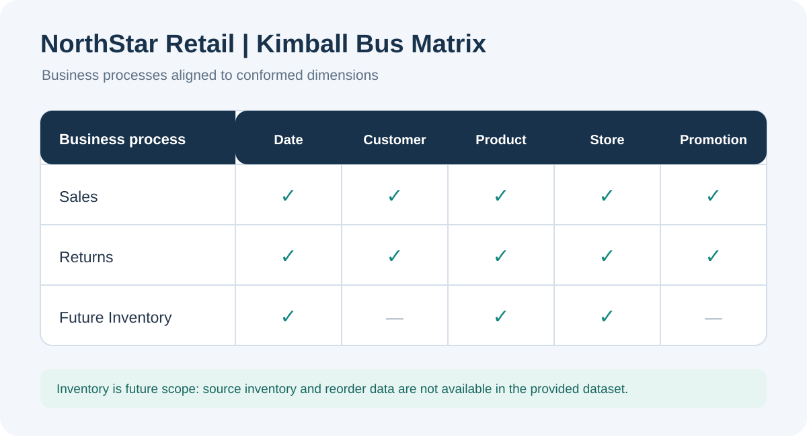

# Kimball Bus Matrix

The bus matrix maps business processes to the conformed dimensions used to analyze them.

| Business process | Date | Customer | Product | Store | Promotion |
| --- | :---: | :---: | :---: | :---: | :---: |
| Sales | X | X | X | X | X |
| Returns | X | X | X | X | X |
| Future Inventory | X | — | X | X | — |

## Interpretation

Date, Product, and Store are shared across Sales, Returns, and future Inventory. Customer supports purchase and return behavior analysis. Promotion is shared by Sales and Returns; return records inherit the original sale's promotion when the source lineage permits. Inventory is future scope because inventory and reorder data are not available in the provided project source data.
