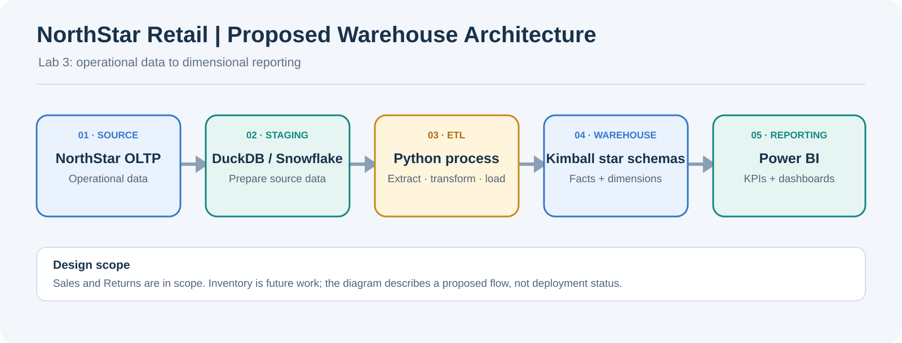

# Phase 3 — Architecture and Data Dictionary

Phase 3 translates the Phase 2 requirements into a proposed warehouse architecture and conceptual data dictionary. The design describes how operational data can move through staging and SQL-based ETL into business-friendly dimensional tables for reporting.

**Figure 1.** Proposed flow from NorthStar operational data to Power BI reporting, using SQL-based ETL without requiring Python.

## Deliverables

| Document | Purpose |
| --- | --- |
| [Architecture and design rationale](architecture.md) | Layers, Kimball versus Inmon, and design decisions |
| [Conceptual data dictionary](data-dictionary.md) | Proposed fact and dimension fields, types, and source mappings |
| [Source-to-target mapping](source-to-target.md) | Mapping rules, unresolved source assumptions, and handoff to implementation |
| [Architecture diagram](architecture.svg) | Visual overview of the proposed data flow |
| [Phase 2 requirements and KPI catalog](../phase%2002-dimentional%20model/Business_Requirements_and_KPIs.md) | Stakeholders and business metadata |

## Scope and status

The Lab 3 design includes Sales and Returns facts, customer, product, store, date, promotion, and return-reason dimensions. `DimReturnReason` supports return analysis; channel remains an attribute of `DimStore`. Inventory remains future scope because inventory and reorder source data are not available in the provided project data.

This phase documents the **proposed** architecture and logical mappings. The ETL can be implemented with SQL; Python is not required. References to staging, Snowflake, and Power BI describe the planned flow and do not establish that a specific pipeline, returns model, or dashboard is already deployed. Field names and types are conceptual, not a guarantee of the physical Snowflake schema.
