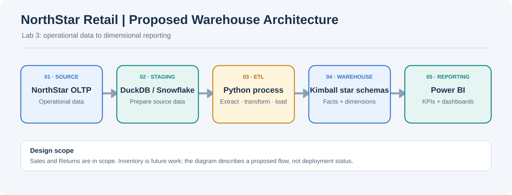

# Architecture and Design Rationale

## Proposed architecture

| Layer | Role in the proposed design |
| --- | --- |
| NorthStar OLTP | Operational source of sales, customers, products, stores, promotions, and returns |
| Staging | DuckDB or Snowflake staging area for preparing source data |
| ETL | Python-based extraction, transformation, and loading into the dimensional model |
| Data warehouse | Kimball-style Sales and Returns facts linked to descriptive dimensions |
| Presentation | Power BI reports and dashboards for KPIs and historical analysis |

These are design layers, not a deployment or operational runbook. Lab 3 does not provide an ETL script, detailed schedule, deployment configuration, or evidence that all layers are running.

## Dimensional design

- **FactSales** represents one sales order line and supports revenue and units-sold analysis.
- **FactReturns** represents one returned order line and supports returned-unit, return-amount, and reason analysis.
- **Dimensions** supply context for date, customer, product, store, promotion, and return reason.
- **Channel** is an attribute of `DimStore`; it is not a standalone dimension in this design.
- **Customer history** is represented by effective date, expiration date, and current-record flag attributes in `DimCustomer`, supporting an SCD Type 2 design.
- **Inventory** is a future process, not a current load: the provided source data does not include inventory and reorder data.

Lab 2's bus matrix associates Promotion with Sales and Returns; Lab 3's fact dictionary does not explicitly list promotion keys in either fact. Promotion attribution, including inheritance from the original sale line for returns, remains a design requirement to resolve in physical mappings rather than a verified implementation. Lab 3 additionally introduces `DimReturnReason` for Returns.

## Why Kimball?

The Kimball approach organizes business processes into dimensional facts and conformed dimensions. A star schema gives business users familiar measures and descriptive attributes for SQL and Power BI reporting. NorthStar's design selects this approach to support sales, returns, and customer analysis.

In the Inmon approach, a normalized enterprise data warehouse is typically built before dimensional data marts. That approach can support enterprise integration but introduces a different modeling and delivery path. The choice of Kimball here reflects the project's reporting focus; neither approach guarantees a particular implementation speed or query performance.

## Business metadata

The Phase 2 KPI catalog records the business meaning and stakeholder for revenue, gross profit, profit margin, units sold, average order value, promotion revenue, repeat-purchase customers, return rate, and returned revenue. The business analytics team is intended to govern these definitions for consistent reporting. See the [business requirements and KPI catalog](../phase%2002-dimentional%20model/Business_Requirements_and_KPIs.md).

## References

Kimball, R., & Ross, M. (2013). *The data warehouse toolkit: The definitive guide to dimensional modeling* (3rd ed.). Wiley.

Microsoft. (n.d.). *Power BI documentation*. https://learn.microsoft.com/en-us/power-bi/
