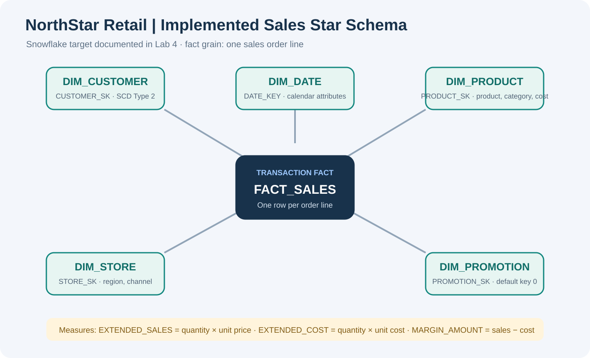

# Phase 4 — Star Schema, ETL, SCD Type 2, and Data Quality

Phase 4 documents the Lab 4 Snowflake implementation of the NorthStar Retail sales warehouse. The implemented star schema contains five dimensions and one sales fact table.

**Figure 1.** Implemented sales star schema documented in Lab 4.

## Deliverables

| Document | Contents |
| --- | --- |
| [Implementation and grain](implementation.md) | Tables, fact grain, surrogate keys, and measures |
| [ETL and SCD Type 2](etl-and-scd2.md) | Load order, fact load logic, default promotion, and customer history |
| [Data-quality results](data-quality.md) | Reported checks, outcomes, and row-count reconciliation |
| [Star-schema diagram](star-schema.svg) | Fact and dimension relationships |

## Reported implementation results

- Snowflake target tables: `DIM_DATE`, `DIM_CUSTOMER`, `DIM_PRODUCT`, `DIM_STORE`, `DIM_PROMOTION`, and `FACT_SALES`.
- `FACT_SALES` grain: one row per sales order line item.
- Fact load: 119,352 rows, matching 119,352 source order items.
- `DIM_DATE`: 1,096 date rows for the reporting period.
- `DIM_CUSTOMER`: 3,309 rows after the reported SCD Type 2 processing.
- Reported checks passed for null keys, referential integrity, duplicate sales, and source-to-fact row-count reconciliation.

These are results reported in the Lab 4 submission; this repository does not contain the Snowflake database or independently rerun those loads.

## Scope boundary

Lab 2 and Lab 3 describe Returns as a warehouse business process, but Lab 4 reports only `FACT_SALES` as implemented. No `FACT_RETURNS` table or return-reason dimension is represented in the Lab 4 table list. Inventory is future scope because inventory and reorder source data are unavailable.
