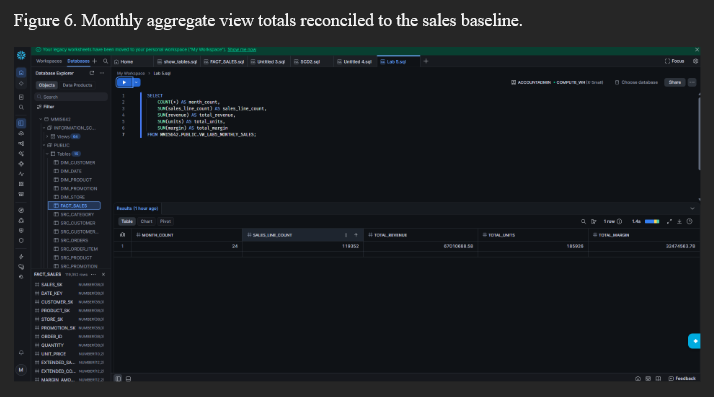
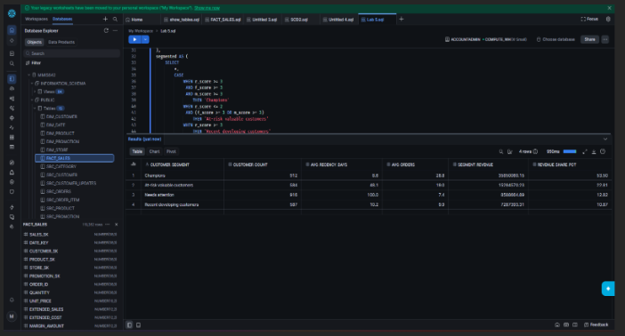
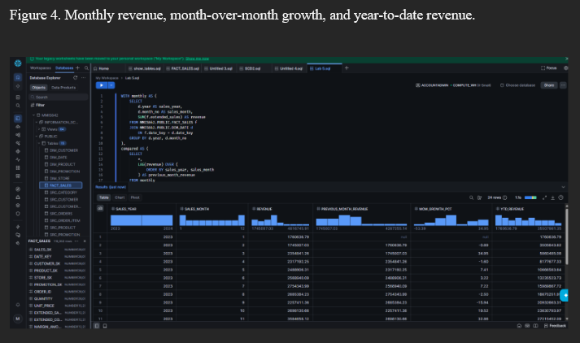

# Phase 5 — OLAP and Analytical SQL Portfolio

Phase 5 analyzes the [Lab 4 sales star schema](../phase04-star-schema-etl/README.md) with Snowflake SQL. The portfolio covers time-based roll-up and drill-down, slice-and-dice analysis, window functions, a reusable monthly sales view, and customer recency, frequency, and monetary value (RFM) segmentation.

## Deliverables

| Document | Contents |
| --- | --- |
| [SQL portfolio](portfolio.sql) | Baseline, OLAP, window, monthly view, validation, and RFM queries |
| [Analytical findings](findings.md) | Reported results, business interpretation, and method limitations |
| [Figure 4 — monthly growth and YTD revenue](figures/figure-4-monthly-growth-ytd.png) | Snowflake window-function screenshot |
| [Figure 6 — monthly view reconciliation](figures/figure-6-monthly-view-reconciliation.png) | Snowflake validation screenshot |
| [Figure 8 — RFM segmentation results](figures/figure-8-rfm-segments.png) | Snowflake result screenshot |

## Reported baseline and reconciliation

| Measure | Lab 5 reported result |
| --- | ---: |
| Sales period | January 1, 2023–December 31, 2024 |
| Sales order lines | 119,352 |
| Distinct orders | 50,000 |
| Revenue | $67,010,688.58 |
| Units | 185,926 |
| Margin | $32,474,563.78 |
| Monthly view rows | 24 |

The monthly view's reported sums for sales lines, revenue, units, and margin reconcile to the fact-table baseline. Because the fact grain is one order line, the baseline and RFM queries count distinct `ORDER_ID` values rather than fact rows as orders.

## Figure 6 — Monthly aggregate view reconciliation

**Figure 6.** Monthly aggregate view totals reconciled to the sales baseline.

## Figure 8 — RFM customer segmentation

**Figure 8.** RFM customer segments and revenue contribution from the Lab 5 Snowflake query.

## Running the portfolio

The queries target `MMIS642.PUBLIC` and the physical table and column names reported in Lab 4. Run them in Snowflake with access to the loaded warehouse; adapt the database and schema qualifiers if necessary. Run the `CREATE VIEW` statement before its validation and reporting queries. It creates `VW_LAB5_MONTHLY_SALES` and requires permission to create a view; it will fail if the view already exists. The view is a standard view that stores a SQL definition, not precomputed results or a guarantee of faster queries.

These are results reported in the Lab 5 submission. The repository does not contain the Snowflake data or execution logs, and the queries and results have not been independently rerun here. Selected Snowflake result screenshots are included with the documentation as submission evidence.

## Figure 4 — Monthly growth and year-to-date revenue

**Figure 4.** Monthly revenue, month-over-month growth, and year-to-date revenue.

## References

- Kimball, R., & Ross, M. (2013). *The Data Warehouse Toolkit: The Definitive Guide to Dimensional Modeling* (3rd ed.). Wiley.
- Snowflake documentation: [GROUP BY ROLLUP](https://docs.snowflake.com/en/sql-reference/constructs/group-by-rollup), [LAG](https://docs.snowflake.com/en/sql-reference/functions/lag), and [CREATE VIEW](https://docs.snowflake.com/en/sql-reference/sql/create-view).
