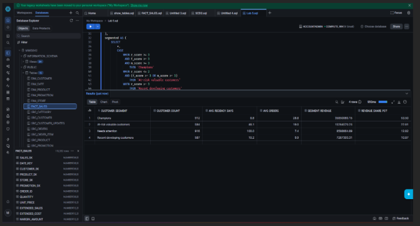

# Analytical Findings

The figures below are reported in the Lab 5 submission for NorthStar's 2023–2024 sales data, not independently verified results.

## Roll-up and drill-down

The time roll-up reports $5,860,485.08 in Q1 2023 revenue and $7,375,038.65 in Q2. Drilling into Q1 shows January at $1,760,636.79, February at $1,745,007.03, and March at $2,354,841.26. Quarterly and monthly detail exposes changes hidden in an annual total; category and regional analysis could help explain them.

## Category and region slice

For 2024 physical-store sales in the Northeast and Southeast, the submission reports 20 category–region combinations. Apparel led revenue in both regions ($1,098,817.21 and $1,093,260.81 respectively), while Beauty & Health had margin percentages of 67.94% and 67.87%. Revenue leadership and margin percentage are different measures; the reported results suggest maintaining Apparel availability while testing margin-conscious Beauty & Health promotions.

## Monthly trends and view

February 2023 revenue decreased 0.89% from January, and March increased 34.95% from February. The query compares each observed month with the previous observed month, including across year boundaries, while the year-to-date running total resets each year. It does not generate rows for months without sales.

The standard monthly view groups by year, quarter, and month. Its reported 24 rows reconcile to 119,352 sales lines, $67,010,688.58 in revenue, 185,926 units, and $32,474,563.78 in margin. It provides consistent reporting logic, but does not store precomputed results; use the fact table when transaction-level detail is required.

## Customer RFM

RFM uses January 1, 2025 as the reference date and groups by `CUSTOMER_ID` to combine purchases across SCD Type 2 versions. Frequency counts distinct orders and monetary value sums order-line revenue. The analysis includes customers with sales in the fact table, not customers without purchases.

The submission reports 2,999 customers in four segments. The 912 Champions generated 53.50% of revenue; 584 at-risk valuable customers contributed 22.81%. Loyalty benefits and targeted reactivation campaigns are potential next steps, but these segments describe relative behavior in the dataset, not confirmed churn or predictions.

**Figure 8.** Snowflake output for the RFM customer segmentation query.

`NTILE(4)` scores customers relative to one another; more recent purchases receive higher recency scores. `CUSTOMER_ID` makes ordering reproducible, but equal values can be split across quartiles, so the scores are not fixed business thresholds.
